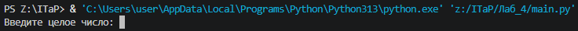
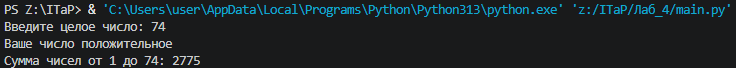
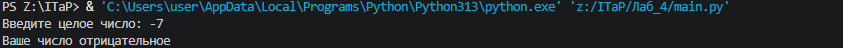
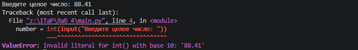
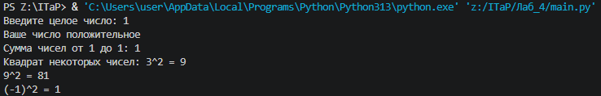

# Отчёт по практической работе

**Дисциплина:** Информационные технологии и программирование  
**Практическая работа №4:** Условия, циклы и функции  
**Вариант:** 2  
**Выполнил:** студент группы ИНС-б-о-26-1 Бобрышов А.В.

---

## Задание 1. Проверка знака числа

### Описание задания

Нужно запросить целое число и определить, какое оно: положительное, отрицательное или равное нулю. Для трёх случаев используется конструкция `if`, `elif`, `else`.

### Ход выполнения

1. Открыт файл `main.py`.
2. Программа запущена из каталога `Z:\ITaP`:

   ```text
   & 'C:\Users\user\AppData\Local\Programs\Python\Python313\python.exe' 'z:/ITaP/Лаб_4/main.py'
   ```

3. Введено число `74`. Программа отнесла его к положительным.
4. Введено число `-7`. Программа отнесла его к отрицательным.
5. Введено значение `88.41`. Это не целое число: `int()` не смог преобразовать строку, и программа завершилась с `ValueError`.
6. Ветка для нуля в коде есть: при `number == 0` выводится сообщение «Ваше число равно нулю». Отдельный запуск с нулём на скриншотах не показан.

### Фрагмент кода

```python
number = int(input("Введите целое число: "))
if number > 0:
    print("Ваше число положительное")
elif number < 0:
    print("Ваше число отрицательное")
else:
    print("Ваше число равно нулю")
```

### Скриншоты выполнения

Запуск программы, ожидается целое число:



Положительное число `74`:



Отрицательное число `-7`:



Некорректный ввод `88.41`:



### Вывод по заданию 1

Для целых чисел `74` и `-7` знак определён верно. Дробный ввод программа не обрабатывает: выполнение прерывается исключением `ValueError`, потому что строка сразу преобразуется через `int()`.

---

## Задание 2. Сумма чисел от 1 до N

### Описание задания

Нужно найти сумму целых чисел от `1` до `N`. В программе верхняя граница — то же число, которое пользователь ввёл для проверки знака. Сумма считается циклом `for` и только тогда, когда число положительное.

### Ход выполнения

1. После проверки знака программа смотрит, больше ли число нуля.
2. Если больше, переменная `total` обнуляется, и цикл `for i in range(1, number + 1)` прибавляет к ней каждое число диапазона.
3. Для `74` программа вывела сумму `2775`.
4. Проверка вручную: сумма от `1` до `N` равна `N * (N + 1) / 2`. Для `74` это `74 * 75 / 2 = 2775`. Результат программы совпал с формулой.
5. Для `-7` блок с циклом не выполняется, строки с суммой на экране нет.
6. Отдельный запуск с числом `1` дал сумму `1`. Это нижняя граница диапазона: цикл выполняет один шаг и прибавляет только само число `1`.

### Фрагмент кода

```python
if number > 0:
    total = int()
    for i in range(1, number + 1):
        total = total + i
    print(f"Сумма чисел от 1 до {number}: {total}")
```

### Скриншот выполнения


### Вывод по заданию 2

Для положительного `N` цикл проходит числа от `1` до `N` включительно и накапливает сумму. Для `74` полученный результат `2775` совпал с ручным расчётом, для `1` сумма равна `1`. Для отрицательного числа сумма не выводится.

---

## Задание 3. Функция square

### Описание задания

Нужна функция `square(x)`, которая принимает число и возвращает его квадрат. Результат функция должна отдавать через `return`, а не печатать сама. По заданию её нужно вызвать несколько раз с разными аргументами.

### Ход выполнения

1. В начале файла описана функция `square`: параметр `x` умножается сам на себя, произведение возвращается через `return`. Внутри функции вывода на экран нет.
2. После расчёта суммы функция вызывается три раза с аргументами `3`, `9` и `-1`. Печать результата стоит в основной части программы.
3. Программа запущена, введено число `1`. На экран вышло:

   ```text
   Квадрат некоторых чисел: 3^2 = 9
   9^2 = 81
   (-1)^2 = 1
   ```

4. Проверка вручную: `3 * 3 = 9`, `9 * 9 = 81`, `(-1) * (-1) = 1`. Все три результата совпали с выводом программы.

### Фрагмент кода

```python
def square(x):
    return x * x

print(f'Квадрат некоторых чисел: 3^2 = {square(3)}')
print(f'9^2 = {square(9)}')
print(f'(-1)^2 = {square(-1)}')
```

### Скриншот выполнения



### Вывод по заданию 3

Функция возвращает квадрат аргумента и сама ничего не печатает. Три вызова с разными аргументами, включая отрицательное число, дали верные результаты: `9`, `81` и `1`.

---

## Общий вывод

В практической работе по варианту 2 сделаны три части: проверка знака числа, сумма от `1` до `N` и функция квадрата.

Проверка знака проверена на числах `74`, `1` и `-7`: сообщения совпали с ожидаемыми. Сумма для `74` равна `2775` и совпала с формулой `N * (N + 1) / 2`, сумма для `1` равна `1`. На дроби `88.41` программа останавливается с `ValueError`, потому что ввод сразу преобразуется в целое число. Функция `square` вызвана с аргументами `3`, `9` и `-1` и вернула `9`, `81` и `1`.

---

## Контрольные вопросы

### 1. Что такое логическое выражение и как оно используется в условиях?

Логическое выражение — это выражение, результат которого равен `True` или `False`. В условии оно решает, выполнять ли ветку. В программе таким выражением является `number > 0`: если оно истинно, печатается сообщение о положительном числе.

### 2. Какие операторы сравнения применяются в Python?

В Python есть шесть операторов сравнения: `==` (равно), `!=` (не равно), `>` (больше), `<` (меньше), `>=` (больше или равно), `<=` (меньше или равно). В этой работе использованы `>` и `<`.

### 3. Как работают конструкции `if`, `elif` и `else`?

`if` проверяет первое условие. `elif` проверяется только если предыдущие условия ложны. `else` выполняется, когда не подошло ни одно условие. В программе сначала проверяется `number > 0`, затем `number < 0`, а оставшийся случай — ноль — попадает в `else`.

### 4. В каких случаях используется цикл `for`, а в каких — цикл `while`?

`for` удобен, когда есть готовая последовательность или заранее известно, сколько раз повторять действие. `while` удобен, когда повторять нужно до тех пор, пока условие остаётся истинным, и число шагов заранее неизвестно. Сумма от `1` до `N` считается циклом `for`, потому что границы диапазона известны сразу после ввода.

### 5. Что делает функция `range()` и как она применяется в циклах?

`range(start, stop)` строит последовательность целых чисел от `start` включительно до `stop` не включая его. В программе `range(1, number + 1)` даёт числа `1, 2, ..., number`, и цикл `for` проходит по ним по одному.

### 6. Как можно управлять итерациями цикла с помощью `break` и `continue`?

`break` сразу прекращает цикл. `continue` пропускает оставшиеся команды текущей итерации и переходит к следующей. В `main.py` эти операторы не используются: цикл суммы всегда доходит до конца диапазона.

### 7. Что такое функция и зачем выделять повторяющиеся действия в отдельные функции?

Функция — это именованный фрагмент программы, который можно вызвать по имени. Повторяющееся действие записывают один раз, а затем вызывают с разными данными. Так проще читать программу и править расчёт в одном месте. `square` как раз выносит возведение в квадрат в отдельное действие.

### 8. Чем параметры функции отличаются от аргументов?

Параметр — это имя в заголовке функции, через которое она принимает значение. У `square` параметр один: `x`. Аргумент — это конкретное значение в момент вызова. В программе функция вызывается как `square(3)`, `square(9)` и `square(-1)`: аргументы `3`, `9` и `-1` по очереди попадают в параметр `x`.

### 9. Для чего используется оператор `return`?

`return` возвращает результат туда, откуда функцию вызвали, и на этом завершает её выполнение. В `square` оператор `return x * x` отдаёт квадрат числа. Без `return` функция завершилась бы и вернула `None`.

### 10. Как область видимости влияет на доступ к переменным внутри и вне функций?

Имя, созданное внутри функции, видно только в ней. Параметр `x` существует, пока выполняется `square`, и снаружи к нему не обратиться. Переменная `number` создана в основной части файла, поэтому её используют проверка знака и цикл суммы. Из функции эта переменная сама по себе не нужна: функция работает со своим параметром.

### 11. Как выполняется декомпозиция задачи при проектировании программы?

Задачу делят на части, которые можно написать и проверить по отдельности. В варианте 2 это три части: определить знак числа, посчитать сумму от `1` до `N` и получить квадрат числа. Знак и сумма стоят в основной программе, квадрат вынесен в функцию `square`.

### 12. Почему важно проверять программу на граничных и некорректных входных данных?

На удобном примере ошибка может не проявиться. Граничные значения — ноль, единица, отрицательное число — проверяют соседние ветки. Некорректный ввод проверяет, не ломается ли программа на неожиданных данных. В этой работе положительное `74`, граница `1` и отрицательное `-7` прошли по разным веткам. Дробь `88.41` показала, что без проверки строки перед `int()` программа завершается с `ValueError`. Отрицательный аргумент `-1` у функции `square` проверил, что квадрат отрицательного числа считается так же, как произведение числа на само себя.
